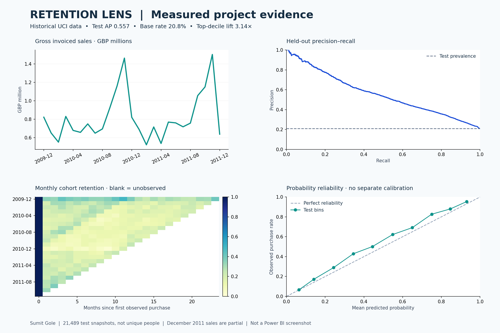

*· E-commerce analytics and 30-day repeat purchase prediction**




A reproducible portfolio project using actual UCI Online Retail II transactions. Python creates cleaned financial/customer tables and point-in-time features; a scikit-learn model estimates repeat purchase probability; Streamlit serves an interactive customer explorer; a five-page Power BI project presents sales, retention, cohorts, predictions and model evidence.

**Delivery status:** ML pipeline trained and tested on the real dataset. Streamlit flows tested. Editable Power BI `.pbip`/PBIR source supplied. **An actual `.pbix` is NOT included: Power BI Desktop on Windows is required to refresh, visually validate and Save As `.pbix`.** No live deployment has been performed. This is an engineering-focused portfolio implementation, not a certified production system.

## Quick start on Windows

Install Python 3.12 (64-bit). Extract this folder to a short path such as `C:\Projects\repeat_purchase`. Double-click `START_WINDOWS.bat`, or use PowerShell:

```powershell
cd C:\Projects\repeat_purchase
py -3.12 -m venv .venv
.\.venv\Scripts\python.exe -m pip install -r requirements.txt
.\.venv\Scripts\python.exe -m src.pipeline
.\.venv\Scripts\python.exe powerbi\build_project.py
.\.venv\Scripts\python.exe -m streamlit run app.py
```

Open the localhost URL printed by Streamlit. A trained model is included, but customer-level CSV exports are not published. Run the pipeline once to download the public UCI source and regenerate local data; no API keys are required. START_WINDOWS.bat does this automatically when needed. The starter script regenerates the Power BI definitions with the local data path; **do not run it after manually editing your report without backing up those edits**.

## Verify and retrain

```powershell
.\.venv\Scripts\python.exe -m unittest discover -s tests -v
$env:OMP_NUM_THREADS="2"
$env:OPENBLAS_NUM_THREADS="2"
.\.venv\Scripts\python.exe -m src.pipeline
```

Retraining downloads the original workbook if absent (about 43.5 MB). It reads over one million lines and may use substantial RAM; first-time data preparation is required before running the demo. Keep scikit-learn and dependency versions pinned when loading the model. Only load trusted joblib files.

## Measured held-out results

| Metric | Result |
|---|---:|
| Test customer-snapshot rows | 21,489 |
| 30-day purchase prevalence | 20.81% |
| Accuracy at threshold 0.27 | 80.37% |
| Always-no-purchase accuracy | 79.19% |
| Average precision | 0.5569 |
| ROC AUC | 0.7906 |
| Precision at threshold 0.27 | 52.98% |
| Recall at threshold 0.27 | 50.37% |
| F1 | 0.5164 |
| Brier score | 0.1299 |
| Precision in highest-scored 10% | 65.33% |
| Lift in highest-scored 10% | 3.14× |

The test combines August–November 2011 snapshots. Rows are repeated customer snapshots, not unique people. Global top-decile results are retrospective pooled evaluation; monthly results are also exported. Threshold 0.27 maximizes validation F1, not business profit. Probabilities are not separately calibrated. No revenue uplift is claimed.

See [publication status](docs/PUBLICATION_STATUS.md) for data exclusions and remaining acceptance.

## Streamlit experience

- Sales overview: gross sales, credits, net invoiced sales, orders and trend.
- Customer prediction: select an existing customer, run model inference and view historical orders/features.
- Retention cohorts: complete-month matrix and separate returning-share/retention trends.
- Campaign shortlist: likelihood/spend filters, known-customer ID CSV lookup and downloadable scores. Unknown IDs stay unscored.
- Model evidence: temporal splits, baseline/model comparison, reliability bins and global permutation importance.

The snapshot is **2011-12-09**, not today's date. The outcome window is `[2011-12-09, 2012-01-08)`; the data does not contain outcomes for this full window. That latest scoring snapshot is not used for reported evaluation.

## Power BI

Run `python powerbi/build_project.py`, open `powerbi/RetentionLens.pbip`, refresh, and complete [the Windows acceptance checklist](docs/POWER_BI_WINDOWS.md). Five preconfigured report pages and DAX measures are supplied. The final `.pbix` requirement remains open until Desktop validation and Save As are complete.

## Project structure

| Path | Purpose |
|---|---|
| `src/features.py` | Cleaning contract and reusable point-in-time feature function |
| `src/pipeline.py` | Download, audit, exports, model selection, evaluation and scoring |
| `app.py` | Streamlit interface |
| `data/processed/` | Locally generated CSVs, snapshots and predictions; excluded from Git |
| `artifacts/` | Trained model, provenance, quality and evaluation records |
| `powerbi/` | Editable report, semantic model, DAX and theme |
| `tests/` | Boundary/leakage, reconciliation, inference parity and app tests |
| `docs/WALKTHROUGH_HINGLISH.md` | Detailed learning and interview walkthrough |
| `docs/MODEL_CARD.md` | Scope, risks, deployment and monitoring |
| `docs/DATA_DICTIONARY.md` | Table grain and metric definitions |

## Data source and attribution

Chen, D. (2012). **Online Retail II** [Dataset]. UCI Machine Learning Repository. https://doi.org/10.24432/C5CG6D

Source: https://archive.ics.uci.edu/dataset/502/online+retail+ii · License: **CC BY 4.0**. UK non-store giftware retailer; many customers are wholesalers; December 2009–December 2011. Changes: duplicate filtering, invalid-line exclusion, separation of credits, invoice aggregation, feature engineering and derived predictions. The original source is not endorsed by this project. Original workbook checksum is in `artifacts/provenance.json`. Raw workbook is intentionally excluded from the ZIP; pipeline downloads it from the source.

No product categories, costs, margins, marketing exposure, consent, or causal campaign outcomes are fabricated. Streamlit hosting instructions are in `docs/DEPLOYMENT.md`; a public app has not been deployed. Power BI Desktop acceptance and actual PBIX export remain required.
